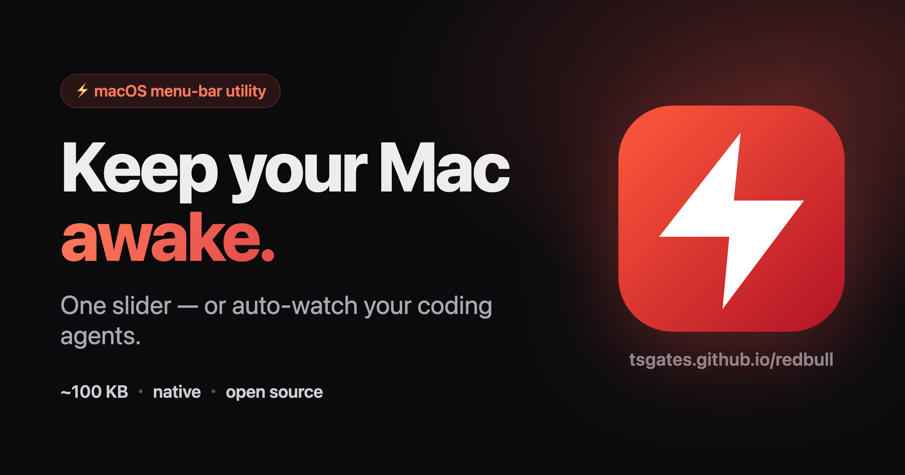

<div align="center">



# Redbull

**A tiny macOS menu-bar app that keeps your Mac awake.**

One slider — from 15 minutes to forever. No windows, no fuss.

[](https://github.com/tsgates/redbull/releases/latest)
[](https://github.com/tsgates/redbull/releases)


[](LICENSE)

[**Website**](https://tsgates.github.io/redbull/) · [**Download**](https://github.com/tsgates/redbull/releases/latest)

</div>

---

Redbull lives in your menu bar as a lightning bolt. Click it, drag the slider to a
duration, and your Mac stays awake until the timer runs out. It's a clean front-end
for the system `caffeinate` tool — **~100 KB**, native Rust + AppKit, **~0% idle CPU**,
no daemon, no login, no Electron.

## Install

### Homebrew

```sh
brew install --cask tsgates/tap/redbull
```

### Direct download

1. Grab the `.dmg` for your chip (**Apple Silicon** or **Intel**) from the
   [releases page](https://github.com/tsgates/redbull/releases/latest).
2. Open it and drag **Redbull** into Applications.
3. Launch it and click the ⚡ in your menu bar. Redbull is signed and notarized by
   Apple, so it opens without Gatekeeper warnings.

### Build from source

```sh
git clone https://github.com/tsgates/redbull
cd redbull
cargo run                # quick run (debug)
./package.sh             # build Redbull.app (native, stable Rust)
./release.sh             # size-optimized arm64 + x86_64 .dmg/.zip (nightly)
```

## Features

- **One slider** — drag from `Off` to `∞`. The whole control is a single tick slider.
- **Sensible presets** — 15 m, 1 / 2 / 3 / 6 / 12 h, or indefinitely.
- **Live countdown** — the menu-bar bolt shows time remaining, fixed-width so it never jitters.
- **Featherweight** — a ~100 KB native binary; ~0% CPU when idle.
- **Zero config** — no account, no preferences, no login item.
- **Open source** — built on `caffeinate`; read every line.

## Auto mode: stay awake while agents work

Click the pulse button and Redbull watches your coding agents instead of a timer:
the Mac stays awake while any agent session is working, and for 5 minutes after
the last one goes idle. Each session is counted separately.

Recognized agents: **Claude Code**, **Codex**, **GitHub Copilot CLI**,
**Gemini CLI**, **opencode**, **Cursor CLI**, **Aider**, **Goose**, **Amp**,
**Qwen Code**, **Crush**, **Factory Droid**, **Auggie**, **Kiro / Amazon Q**,
**Cline**, **Kilo Code**, **OpenHands**, **Continue**, **DeepSeek Harness**,
**Pi**, **oh-my-pi**, **Open Interpreter**, **Codewhale**, **Reasonix**,
**Deep Agents Code**, **Grok Build / Grok CLI**, **Prime Agent**, **jcode**,
**MiMo Code**, **Kimi Code**, **ForgeCode**, **Mistral Vibe**, **Junie**,
**Hermes Agent**, **Roo Code CLI**, **Letta Code**, **Command Code**,
Trae Agent, SWE-agent, gptme, Plandex and Codebuff. Agents running in **VS Code** (Copilot chat, Cline, Roo Code),
**Cursor**, **Windsurf** and **Zed** are watched through their session storage.

A session counts as working when the agent reports it as busy (Claude Code),
when its transcript keeps growing, when its terminal shows output, when it
runs heavy builds or tests, or (for headless runs) while a tool call is in
progress. An agent waiting at its prompt doesn't count, and neither do idle
network chatter or background servers. To see what Redbull sees:

```sh
/Applications/Redbull.app/Contents/MacOS/redbull scan
```

## Agent activity: see what your agents are doing

Click the list button in the popover to open the **Agent activity** window: every
running agent session, whether it's working (and why), its project, the commands
it's running right now, and a live feed of what it has been up to.

- **Claude Code**, **Codex**, **Copilot CLI**, **Open Interpreter**, **Pi**,
  **oh-my-pi** and **Prime Agent** — prompts, tool calls and replies, read from
  the session's own transcript.
- **Every other agent** — when it starts and stops working, and the commands it
  launches (builds, tests, git…), seen in the process table.

The **Files** tab lists what those sessions read and modified, taken from
their file tools and patches (files touched only by shell commands aren't seen).

Pick a session for its own feed, or stay on *All activity* for everything at
once. Redbull only reads these files, locally, and only while the window is open;
nothing leaves your Mac. The same data as JSON:

```sh
/Applications/Redbull.app/Contents/MacOS/redbull activity
```

## License

[MIT](LICENSE)
